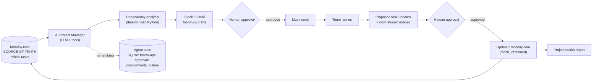
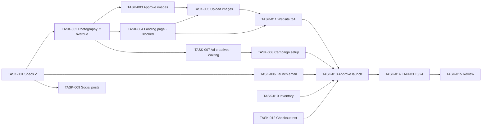

# Week 8, Day 6: AI Project Manager Agent

*Part of Alex Figura's **10 Weeks to AI Agents** series.*

A complete, runnable AI Project Manager for **Northstar Supply**, the fictional ecommerce company from Week 8. It watches a Monday.com-style project board, works out **which delay is actually holding everything up**, checks Slack and email before asking anyone anything, drafts a follow-up to the right person, waits for your approval, "sends" it (in a safe mock workspace), reads the reply, recalculates the downstream impact, proposes board updates, and writes a project health briefing. It remembers all of this between runs.

> **Safe by default.** Everything uses fictional data and mock Monday.com, Slack and Gmail backends stored in a local SQLite file. No real message is ever sent and no real board is changed. Every send and every task change needs your explicit approval.

---

## Why this is more than a reminder bot

A reminder automation says:

> "Sarah, your photography task is overdue."

This agent notices that Sarah's product photography is **blocking two other workstreams**: James's landing page and Kevin's ad creatives. Instead of pinging all three people, it:

1. checks the board, Slack and email, and finds the photographer's email saying the shoot must be rescheduled (but no new date),
2. asks **only Sarah**, mentioning what it already knows,
3. reads her reply ("We'll have the final images on Wednesday"),
4. treats Wednesday as an **estimate**, not proof of delivery,
5. recalculates the schedule: two downstream tasks now project one day late, and the launch loses a day of buffer **but is not delayed**,
6. proposes a board update and short heads-ups to James and Kevin, and raises two decisions for the project lead,
7. applies only what you approve, and reports the new state.

The core lesson of Day 6: **dependency-aware planning plus persistent, two-way communication.** The agent doesn't just monitor a project. It coordinates the work needed to move it forward.

---

## What you'll learn

- **Project management agents:** how one LLM plus deterministic tools coordinates real work.
- **Monday.com task retrieval:** boards, items, column values, updates, and mapping messy boards to a clean schema.
- **Slack and Gmail concepts:** reading conversations, drafting, threading, identities, scopes, events.
- **Dependency analysis:** graphs, transitive dependents, cycle detection, working-day schedule projection.
- **Intelligent prioritization:** why "most days overdue" is the wrong ranking.
- **Two-way communication:** turning messy replies into structured estimates, blockers and commitments.
- **Persistent state:** follow-ups, approvals, proposals and history that survive restarts.
- **Human approvals:** enforced in code, bound to the exact message or change.
- **Follow-up scheduling:** spacing, reply windows, working hours, escalation, deduplication.
- **Project health reporting:** transparent rules, not made-up probabilities.
- **Evaluations:** deterministic tests plus model-based checks.
- **Claude Skills:** packaging the same expertise as a downloadable Skill.

---

## Architecture



Monday.com remains the **source of truth** for official task records. The agent's own database stores what it asked, what people said, what it proposed and what you approved. It never keeps a competing copy of a task's status.

**Who does what:**

| Python (deterministic, tested) | The LLM (judgment) |
|---|---|
| Task retrieval, dependency graph, date math, schedule projection | Choosing what to investigate and which tools to call |
| Follow-up rules (duplicates, spacing, working hours, escalation) | Deciding whether existing context already answers the question |
| Approval enforcement, persistence, duplicate-event handling | Deciding who to ask and writing a natural message |
| Applying approved mock updates, validating everything the model returns | Interpreting messy replies, explaining risks, recommending actions |

More detail: [docs/architecture.md](docs/architecture.md).

---

## Repository structure

```text
├── run.py                  # Entry point: python run.py <command>
├── pyproject.toml          # Dependencies (openai, python-dotenv; optional matplotlib, pytest)
├── .env.example            # Copy to .env (never commit .env)
├── config/policy.json      # Working hours, holidays, follow-up spacing, escalation, message rules
├── agent/
│   ├── system-prompt.md    # The agent's role, rules and prompt-injection defenses
│   ├── scope.md
│   └── workflows/          # 8 focused procedures loaded per task (health check, dependencies, follow-ups…)
├── knowledge-base/         # Company context, PM rules, status definitions, follow-up/approval/escalation policy
├── data/                   # Fictional data: Monday board, Slack, Gmail, team, and 5 scenarios
├── src/project_manager_agent/
│   ├── agent.py            # OpenAI tool-calling loop + offline rules engine
│   ├── cli.py, demo.py     # Commands and the 14-stage walkthrough
│   ├── storage.py, clock.py, config.py, models.py, logging_utils.py, actions.py, scenarios.py
│   ├── monitoring/         # overdue/stale/conflicts, priority scoring, project health
│   ├── dependencies/       # graph, scheduling (forward pass), impact analysis
│   ├── communications/     # follow-up rules, drafting + linter, reply processing, commitments
│   ├── approvals/          # action policy + hash-bound approval requests
│   ├── tools/              # model-facing tools (read / analyze / draft / propose only)
│   ├── integrations/       # mock Monday/Slack/Gmail + adapter contracts + Monday normalizer
│   └── reporting/          # Markdown briefing + optional PNG charts
├── evals/                  # test-cases.json + run_evals.py (deterministic + model-based)
├── tests/                  # pytest suite (offline)
├── claude-skill/project-manager/  # The standalone Claude Skill
├── scripts/build_skill.py  # Builds dist/ai-project-manager-skill.zip
├── dist/                   # The built Skill ZIP (ready to download)
├── docs/                   # Architecture, dependencies, two-way comms, real integrations, production, troubleshooting
├── state/                  # Your local database + logs (git-ignored)
└── reports/                # Generated briefings (git-ignored)
```

---

## Prerequisites

- **Python 3.10+** (developed and tested on **Python 3.11.8**, macOS).
- **Git.**
- **An OpenAI API key** for model-backed investigation and reply interpretation. *Optional:* everything else, including the full demo, runs offline with the deterministic rules engine.
- Dependencies (installed below): `openai`, `python-dotenv`; optional `matplotlib` (charts) and `pytest` (tests).

---

## Quick start

### 1. Clone the repository

```bash
git clone https://github.com/walexfigura/Week-8-Day-6-AI-Project-Management-Agent.git
cd Week-8-Day-6-AI-Project-Management-Agent
```

### 2. Create a virtual environment

macOS / Linux:
```bash
python3 -m venv .venv
source .venv/bin/activate
```

Windows (PowerShell):
```powershell
py -m venv .venv
.venv\Scripts\Activate.ps1
```

### 3. Install dependencies

```bash
pip install -e ".[dev]"            # add ,charts for PNG charts: pip install -e ".[dev,charts]"
```

### 4–5. Create `.env` and add your API key

macOS / Linux: `cp .env.example .env`  ·  Windows: `copy .env.example .env`

Open `.env` and set `OPENAI_API_KEY=sk-...`. Optionally set `PM_APPROVER=Your Name` (otherwise your OS user name is recorded as the approver). **No key?** Skip this. Add `--offline` to `investigate`, `simulate-reply` and `demo`.

```bash
python run.py doctor               # checks Python, packages, data integrity, state, credentials
```

### 6. Initialize the fictional project

```bash
python run.py init
```
```
Initialized scenario 'launch-delay'. Simulated clock: 2026-03-10T09:30:00-04:00.
```

The agent uses a **simulated clock** (Tuesday, March 10, 2026, 9:30 ET), not your computer's date, so every example works the same forever.

### 7. Run the health check

```bash
python run.py health
python run.py blockers             # overdue tasks, bottlenecks, what each blocked task waits on
python run.py tasks --graph        # every task + projected finish + Mermaid dependency graph
```
```
Health: At Risk
  - [At Risk] TASK-002 (Complete product photography) is 1 day(s) overdue with 9 open downstream task(s).
  - [At Risk] Milestone 'Launch campaign approved' has only 1 workday(s) of projected slack.
  - [At Risk] Milestone 'Product launch' has only 2 workday(s) of projected slack.
  - [Needs Review] TASK-009 has no owner update for 6 day(s).
  - [Needs Review] TASK-002 is overdue and has no current estimate from its owner.
```

### 8. Investigate the photography blocker

```bash
python run.py investigate --task TASK-002          # model-backed (needs API key)
python run.py investigate --task TASK-002 --offline  # deterministic rules engine
```

The agent reviews the board, Slack and email, decides who to ask, and **drafts** (never sends) a follow-up. The offline engine produces:

```
Deliberately not contacted
  - TASK-004 (James Okafor): Waiting on TASK-002 (Complete product photography). Ask Sarah about the shared blocker first...
  - TASK-007 (Kevin Liu): Waiting on TASK-002 ...
  - TASK-010 (Alex Rivera): Fresh owner update UPD-1007 at 2026-03-09T16:40:00-04:00 already answers it.

Follow-ups drafted (NOT sent)
  FU-xxxxxxxx [pending_approval] slack -> Sarah Patel about TASK-002
    "Hey Sarah! Checking in on the product photos. James's landing page and Kevin's ad creatives are waiting on them.
     I saw the note from Lumen Studio about rescheduling. Do you have a new date for them?"
```

With a model, the wording is the model's own. It still goes through the same rules, recipient checks and message linter.

### 9. Review the Slack follow-up

```bash
python run.py followups            # the follow-up plan + every follow-up record
python run.py approvals            # pending requests, showing the EXACT message, recipient and channel
```

### 10. Approve and "send" the simulated message

IDs are generated, so copy the `APR-…` ID that `approvals` printed:

```bash
python run.py approve --request APR-XXXXXXXX       # shows the action, then type: approve
python run.py apply-approved --request APR-XXXXXXXX
```
`apply-approved` records the message in the mock Slack DM and reports `"No real message was sent."` Running it again does nothing twice.

### 11. Process Sarah's reply

```bash
python run.py simulate-reply --scenario photography_delayed            # model interprets (API key)
python run.py simulate-reply --scenario photography_delayed --offline  # rules interpreter
```
```
Reply MSG-IN-…: "The photographer had to reschedule. We'll have the final images on Wednesday."
  Task: TASK-002 via reply_in_followup_thread (confidence high)
  Intent: timeline_update
  New estimated completion: 2026-03-11 (Wed Mar 11, from 'Wednesday')
  Blocker: Photographer had to reschedule
  Completion confirmed: False  ·  requires approval: True

  Dependency impact: ... Projected past their own due dates: TASK-003 (-1 workday(s)), TASK-007 (-1 workday(s)).
  Milestone Launch campaign approved (2026-03-20): still feasible; slack 1 -> 0 workday(s).
  Milestone Product launch (2026-03-24): still feasible; slack 2 -> 1 workday(s).

  Created (all pending human approval):
   - task_update_proposed (TASK-002 due date 2026-03-09 -> 2026-03-11 + note)
   - downstream_notice_drafted (James, TASK-004) · downstream_notice_drafted (Kevin, TASK-007)
   - decision_requested ×2 (TASK-003 and TASK-007 now project past their due dates)
```

`python run.py simulate-reply --list` shows every fictional reply, including the ambiguous ones.

### 12. Approve the proposed task update

```bash
python run.py approvals                                  # shows "Change task deadline: 2026-03-09 -> 2026-03-11"
python run.py approve --request APR-XXXXXXXX
python run.py apply-approved --request APR-XXXXXXXX      # the mock Monday.com board now changes (version 1 -> 2)
```
Approve the two downstream notices the same way if you want James and Kevin "told".

### 13. Generate the updated report

```bash
python run.py report               # writes reports/project-health-<time>.md and reports/latest.md
python run.py report --charts      # + PNG charts if matplotlib is installed
python run.py history              # communication log, board changes, commitments, processed events
```

### Or do it all in one guided run

```bash
python run.py demo                 # interactive: you type 'approve' at each gate
python run.py demo --offline       # same, no API key needed
python run.py demo --non-interactive  # stops at each approval gate and prints the commands to run
```
The demo walks all **14 stages** (scan → investigate → prioritize → draft → approve → send → reply → interpret → reassess → propose → approve → persist → report → resume). Quit at any gate and run `python run.py demo` again later. It picks up from the saved state. Start over with `python run.py reset-demo`.

---

## Understanding the fictional project

**TrailMate 32oz Insulated Bottle Launch**: launch **Tuesday, March 24, 2026** (two weeks after the simulated "today").

| Person | Role | Owns |
|---|---|---|
| Sarah Patel | Creative / Photography | TASK-002 product photography |
| James Okafor | Web Development | Landing page, image upload, website QA, checkout test |
| Kevin Liu | Advertising | Ad creatives, campaign setup |
| Emma Rossi | Marketing | Launch email, social posts, post-launch review |
| Alex Rivera | Project Lead | Specs, image approval, inventory, launch approval, launch |

There is also **Sarah Kim** in Finance (not on the project), so a name-only match on "Sarah" is ambiguous on purpose. All contacts use `.example` domains.

**The situation:** Photography (TASK-002) was due **yesterday** and is still In Progress; the board wasn't updated. The landing page (TASK-004) is **Blocked** and the ad creatives (TASK-007) are **Waiting**, both on the photos. The photographer emailed Sarah that the shoot must be rescheduled but gave no date. Inventory has a fresh update. Social posts have gone stale. A Slack guest and a vendor email both contain prompt-injection attempts.



Five scenarios live in `data/scenarios/`: `launch-delay` (default), `missing-update`, `conflicting-deadlines`, `completed-task`, `duplicate-replies`. Load one with `python run.py reset-demo --scenario conflicting-deadlines`.

---

## How dependency analysis works

Python builds a real graph from task IDs (`dependencies/graph.py`): direct and transitive dependencies and dependents, cycle detection, reference validation. A **forward-pass projection over working days** (`dependencies/scheduling.py`) estimates when each task can finish, given its dependencies and remaining effort, and compares that to its due date (slack).

Why this matters more than an overdue reminder: TASK-002 is only one day late, but nine tasks sit downstream, two of them owned by people already waiting. The priority score (`monitoring/priorities.py`) is transparent. You can see each component:

```
TASK-002 score 34.0 from downstream_tasks, direct_dependents_blocked, milestone_downstream,
                       milestone_slack_tight, overdue, business_priority, no_current_estimate
```

And a delay **doesn't automatically delay the launch.** With photos on Wednesday, the projection shows TASK-003 and TASK-007 slipping a day, the landing page still on time, and the launch keeping one working day of slack. The agent says "at risk", not "delayed". It's honest about limits too: this is a deadline-risk check, not a full critical-path method. See [docs/dependency-management.md](docs/dependency-management.md).

## How two-way communication works

1. **Agent → Sarah** (after your approval): *"Hey Sarah! Checking in on the product photos. James's landing page and Kevin's ad creatives are waiting on them…"*
2. **Sarah → Agent:** *"The photographer had to reschedule. We'll have the final images on Wednesday."*
3. **Agent:** links the reply to TASK-002 because it arrived **in the thread of the follow-up it sent** (never because of a name in the text). Extracts `2026-03-11` as an **estimate** and the blocker, and keeps `completion_confirmed: false`.
4. **Proposes:** TASK-002 due date → 3/11 plus a note saying it's an owner estimate; heads-ups to James and Kevin; two decisions for Alex about the knock-on dates.

Ambiguous replies are handled conservatively. Each gets a clarification draft instead of a guess:

| Reply | Interpreted as |
|---|---|
| "Should be done tomorrow." | timeline update (tentative estimate) |
| "Still waiting on design." | blocker, no date. Asks what exactly and when |
| "I think we're good." | ambiguous. Asks "delivered, or what date?" |
| "Can we push it to next week?" | deadline-change request. Decision for the lead, no date invented |
| "Done, just needs review." | completion **claim**. Note only, status stays In Progress |
| "I sent this yesterday." | delivery claim. Unverified, asks where it went |
| "Ask Kevin, he's handling it now." | ownership redirect. No reassignment, decision for the lead |

Processing the same reply event twice creates nothing new. See [docs/two-way-communications.md](docs/two-way-communications.md).

## Persistent state

Everything lives in `state/northstar_pm.db` (SQLite):
- `monday_*`, `slack_*`, `gmail_*`: the **mock external systems** (approved changes really persist here),
- `agent_*`: follow-ups (recipient, channel, draft, approval, sent time, thread, reply status, next allowed follow-up, current commitment), approval requests, proposals, processed events, commitments, blockers, lead decisions, investigations, health history, task snapshots, exemptions,
- `meta`: the simulated clock and scenario.

Close the terminal, come back tomorrow, run `python run.py followups`, and you're exactly where you left off. `init` never overwrites existing state. `reset-demo` restores the original. `python run.py clock --advance-hours 8` moves simulated time forward (handy for testing reminder spacing).

## Human approvals

| Automatic | Requires your approval | Prohibited by default |
|---|---|---|
| Read project records, tasks, conversations | Send Slack messages | Live (real) messages |
| Analyze dependencies, assess health | Send emails | Modifying live Monday.com boards |
| Draft messages | Change deadlines, status, owners | Deleting tasks |
| Propose task updates | Add/remove dependencies, move milestones | Changing permissions |
| Create follow-up records, prepare briefings | Update official records, announcements | Financial commitments; unapproved recipients |

Enforced in code (`approvals/`): each request stores the **exact** payload and its SHA-256 hash. `approve` shows you that exact action and records your name. `apply-approved` re-verifies the hash, so approving message A can never send message B or reach a different person. The agent can't approve its own actions, and the model has no send/approve/apply tools at all.

## Project health reporting

`python run.py report` builds a Markdown briefing **only from persisted state**: executive summary, why-this-classification (each rule that fired), key metrics, upcoming milestones (due / projected / slack), the most important blockers with the latest commitment, latest updates with timestamps, pending decisions and approvals, recommended next steps, a Mermaid dependency graph, and a source-reference table (task, owner, status, due, projected finish, basis, latest owner signal).

Classifications are transparent rules: **Blocked** (milestone projected to slip, invalid graph, ownerless blocker) › **At Risk** (overdue with downstream work, milestone-feeding task projected late, milestone slack ≤ 2 days) › **Needs Review** (conflicts, stale updates, unanswered follow-ups, missing estimates, open decisions) › **On Track**. They are not success probabilities.

---

## Claude Skill

The same expertise, packaged for Claude: `claude-skill/project-manager/` (SKILL.md + 11 reference files + fictional sample data).

**Get the ZIP:** download `dist/ai-project-manager-skill.zip` from this repo, or rebuild it:
```bash
python run.py build-skill          # validates frontmatter + references, regenerates sample data, writes the ZIP
```

**Install:** in Claude, go to **Settings → Capabilities**, enable Skills, and upload the ZIP. Menu names may change, so check Anthropic's help docs if yours differ. Start a new chat.

**Try it with the fictional project (no connectors):**
- "Review our project and tell me which tasks need attention."
- "Which person should we follow up with first?"
- "Draft that follow-up."
- "Sarah replied: 'The photographer had to reschedule. We'll have the final images on Wednesday.' What changes?"
- "Write the project health report."

**Without connectors** it analyzes the bundled data, drafts messages and proposes updates, and labels anything "sent" as a simulation. **With connectors** (Monday.com, Slack, Gmail), it first checks which tools actually exist, maps your board's columns, reads before asking, and asks for approval of the exact message or change before calling a write tool. It reports only what a tool result confirms.

**Limits, honestly:** a Skill is instructions. It has no scheduler, database or background monitoring of its own. It offers a follow-up log you can save and paste back next session. Persistent coordination needs connected systems or something like this repo's Python app.

---

## Connecting real Monday.com, Slack and Gmail

The default demo needs **no real accounts**. To go further, read [docs/integrating-real-systems.md](docs/integrating-real-systems.md), which covers credentials, OAuth scopes, Monday.com column mappings (`MondayColumnMapping`), pagination, rate and complexity limits, webhooks/Events API/Gmail push, threading, recipient validation and security.

**What exists today:** fully working mock integrations; a Monday.com item **normalizer** tested against a fixture shaped like the documented GraphQL response; GraphQL query text. **What doesn't:** live HTTP clients or live write paths. None of it has been run against real accounts, and live sending is prohibited by policy until you add real auth, idempotent executors, rate-limit handling and auditing.

---

## Testing and evaluations

```bash
python -m pytest                   # 83 offline tests
python run.py eval                 # 23 deterministic evaluation cases (T01–T23)
python run.py eval --llm           # + model-based cases (needs OPENAI_API_KEY)
```

- **Deterministic** (always offline): dates, graphs, cycles, schedule impact, prioritization, follow-up spacing and dedupe, reply rules, approvals and approval integrity, persistence across restarts, duplicate events, prompt injection, wrong recipients, tool failures, report accuracy, and the full end-to-end workflow.
- **Model-based** (`--llm`): the real agent's prioritization, avoiding already-answered questions, risk explanation, message quality (LLM-judge rubric, ≥ 4/5), interpretation of every scenario reply against expected structured fields, and prompt-injection resistance. Graded on fields and rubric scores, never exact wording.

Results are written to `reports/eval-results.json`, with deterministic and model-based results kept separate. Without a key, the model-based section says it was skipped, not that it passed.

---

## Exercises

1. **Add a dependency:** make TASK-006 (launch email) depend on TASK-003 in `data/monday/dependencies.json`, run `reset-demo`, and see how `blockers` changes.
2. **Change a deadline:** move TASK-014 to 2026-03-27 in `tasks.json`. Does the health classification change?
3. **Create a circular dependency:** add `{"task_id": "TASK-001", "depends_on": "TASK-014"}`. Watch `health` become **Blocked**, then remove it.
4. **Add a team member:** add a sixth person in `team-members.json` and give them a task.
5. **Introduce an overdue task:** set TASK-006's due date to 2026-03-06. Who does the agent ask first now, and why?
6. **Simulate a different reply:** add a reply to `data/scenarios/launch-delay/scenario.json` (e.g. "Images are uploaded to the shared drive") and run it. How is it classified?
7. **Add an unanswered follow-up:** send Sarah's follow-up, then `clock --advance-hours 10` and run `followups` and `health`.
8. **Change reminder frequency:** set `min_working_hours_between_followups` to 4 in `config/policy.json` and re-run test T15's steps by hand.
9. **Add a milestone:** add "Website ready" (TASK-011, due 2026-03-19) to `projects.json` and see it in the report.
10. **Create a second project:** add a project and tasks with a new `project_id`. Hint: `default_project_id()` picks the first project. Extend the CLI with `--project`.
11. **Trigger an escalation:** send Sarah two follow-ups without a reply (advance the clock between them), then run `investigate --offline` and look for the escalation decision.

---

## Troubleshooting

Common fixes (full table in [docs/troubleshooting.md](docs/troubleshooting.md)):

- **Python environment:** use `python3` on macOS/Linux if `python` isn't found. Activate the venv before installing.
- **Missing dependencies:** `pip install -e ".[dev]"`. `python run.py doctor` tells you what's missing.
- **Invalid API key:** check `.env` (no quotes or spaces), or run with `--offline`.
- **Missing mock data:** `git checkout data/`. `doctor` validates every file and dependency.
- **Conflicting task records:** `health` lists conflicts with both sources. Approve a proposal to resolve, or `reset-demo`.
- **Duplicate follow-ups:** by design you'll see "already queued"/"wait". `followups` shows why.
- **Invalid approvals:** a changed payload or a stale board version is refused. Re-run the analysis for a fresh request.
- **Unexpected task statuses:** `history` shows every approved board change. `reset-demo` restores the original.
- **Incorrect simulated dates:** the scenario clock is used, not your system date. `python run.py clock` shows it.
- **State reset:** `python run.py reset-demo`.

---

## Safety and limitations

- Fictional company, people and data. All addresses use reserved `.example` domains.
- Mock Monday.com, Slack and Gmail. **Nothing is sent to real people and no real board is modified**, even after approval.
- Message text, emails and task updates are treated as untrusted data. Injected instructions are ignored and flagged.
- Schedule projection is a transparent deadline-risk check, not a full critical-path method. Health classifications are rules, not probabilities.
- The offline rules interpreter handles the documented scenarios and flags everything else as ambiguous. The model handles messier language.
- Model output varies. The model-based evals check structure and quality, not exact wording.

## Credits and license

Created by **Alex Figura** as Week 8, Day 6 of the **10 Weeks to AI Agents** series. Licensed under the MIT License included in this repository (see [LICENSE](LICENSE)).
