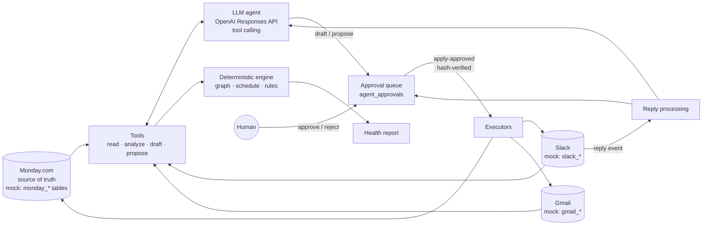

# Architecture

## The big picture



## Division of responsibilities

| Python (deterministic, tested) | LLM (judgment) |
|---|---|
| Task retrieval, schema normalization | Choosing what to investigate and which tools to call |
| Dependency graph traversal, cycle detection | Deciding whether existing context already answers a question |
| Working-day date math, schedule projection | Choosing who to follow up with, and why |
| Follow-up rules: duplicates, spacing, reply windows, caps, exemptions, working hours | Writing natural, specific messages |
| Persistence, idempotency, duplicate-event handling | Interpreting messy replies (intent, blocker, dates) |
| Approval enforcement (payload hashing), official mock updates | Summarizing risks, recommending next actions |
| Data validation of everything the model returns | |

The model never executes arbitrary code, files or SQL. It calls a fixed set of tools whose arguments are validated, and none of those tools send, approve, apply or delete (`tools/registry.py` refuses to even register such a tool).

## Packages (`src/project_manager_agent/`)

| Module | Responsibility |
|---|---|
| `config.py`, `clock.py`, `logging_utils.py` | Settings, simulated clock + business calendar + date parsing, JSONL logs with trace IDs |
| `storage.py` | SQLite schema for mock systems (`monday_*`, `slack_*`, `gmail_*`, `people_*`) and agent state (`agent_*`) |
| `models.py` | Statuses, reply intents, interpretation schema + validation, canonical payload hashing |
| `dependencies/` | `graph.py` (traversal, cycles), `scheduling.py` (forward pass), `impact.py` (what-if analysis) |
| `monitoring/` | Overdue/stale/conflict detection, transparent priority scoring, health classification |
| `communications/` | Follow-up rules and records, message templates + linter, reply processing, commitments |
| `approvals/` | Action policy table, approval requests (create, decide, verify, execute) |
| `integrations/` | Mock Monday/Slack/Gmail, adapter protocols, Monday.com normalization |
| `tools/` | Model-facing tools: schemas, permissions, safe execution |
| `actions.py` | Executors for approved actions + bookkeeping |
| `agent.py` | The tool-calling loop (investigate, interpret_reply) and the offline rules engine |
| `reporting/` | Markdown briefing, optional charts |
| `scenarios.py`, `demo.py`, `cli.py` | Scenario overlays and simulated replies, the 14-stage demo, the CLI |

## The agent loop

```
instructions = system-prompt.md + scope.md + relevant workflow docs
input        = simulated time + scope + request
tools        = allowed read/analyze/draft/propose tools + submit_<task>
loop (max PM_MAX_ITERATIONS):
    response = responses.create(..., tool_choice="required")
    for each function_call:
        submit_<task>   -> validate in Python; errors go back to the model (max 2 retries)
        other tool      -> validate args, run, return JSON (truncated to PM_MAX_TOOL_OUTPUT_CHARS)
    stop with an error if PM_MAX_TOOL_CALLS is exceeded
```

The OpenAI SDK retries transient failures (`max_retries=2`) with a request timeout (`PM_REQUEST_TIMEOUT_SECONDS`). Every task gets a trace ID; every tool call is logged to `state/logs/agent-YYYY-MM-DD.jsonl`.

## Offline rules engine

`offline_investigate` and `rules_interpreter` reuse the same deterministic rules and templates so the whole workflow runs without an API key. They are always labeled `offline-rules` / `interpreter: rules` and make no AI judgments.

## Source of truth

Monday.com owns official task records. The agent's tables hold *its* state: what it asked, what people said, what it proposed, what was approved. In mock mode, an approved change writes to `monday_tasks` (with optimistic version checks) and to `monday_change_log`. A real deployment would write via the Monday.com API and re-read the board, never keeping a competing copy of status.
