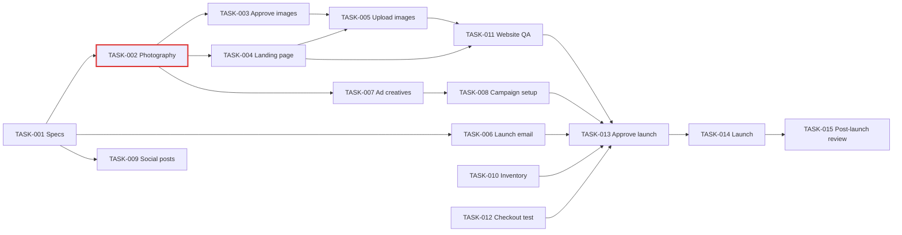

# Dependency Management

## The graph

Each edge `(task, depends_on)` means *task can't finish until depends_on is Done* (finish-to-start). Built from task IDs in `data/monday/dependencies.json` (in production: a Monday.com dependency column).

`DependencyGraph` provides: direct/transitive dependencies, direct/transitive dependents, `find_cycle()` (DFS, returns the cycle path), `invalid_references()`, `topological_order()` and a Mermaid export.

## Schedule projection

`dependencies/scheduling.py` runs a forward pass over **working days** (from `config/policy.json`):

- Done tasks finish on `completed_at`.
- Otherwise, start = later of today or the next working day after every open dependency's projected finish. Finish = start + `estimated_workdays` − 1.
- An **owner estimate** (from a processed reply) replaces the planned finish (`basis: owner_estimate`).
- An overdue task with no estimate is assumed to finish **today at the earliest** (`basis: assumed_today_no_estimate`). This is optimistic and labeled as an assumption.
- Slack = working days between projected finish and due date. Negative means projected late.

`driving_chain()` follows the latest-finishing dependency backwards from a milestone, the chain currently setting its date.

## Impact analysis

`analyze_impact(task, new_finish)` compares baseline vs revised projections for every downstream task and milestone. In the main scenario, with photos on Wed 3/11:

| | Baseline | Revised |
|---|---|---|
| TASK-003 Approve images (due 3/11) | 3/11 | 3/12 (−1) |
| TASK-007 Ad creatives (due 3/13) | 3/13 | 3/16 (−1) |
| TASK-004 Landing page (due 3/16) | 3/13 | 3/16 (0) |
| Launch approval (due 3/20) | slack 1 | slack 0 |
| **Launch (due 3/24)** | slack 2 | **slack 1, not slipping** |

So the right message is *"two downstream dates are now at risk and the launch lost a day of buffer"*, not *"the launch is delayed"*.

## Why the agent asks Sarah, not James and Kevin

`monitoring/priorities.py` scores tasks with visible components (downstream count, blocked dependents, milestone proximity, overdue capped at 3 days, business priority, missing estimate, minus fresh updates/recent contact/partial progress). A Blocked/Waiting task whose problem is an open upstream task is marked `covered_by_upstream`, so its owner isn't chased separately.

## Limitations

- Not a full critical-path method: no resource constraints, no probabilistic durations, no start-to-start or lag relationships, no modelling of partial overlap (the `partial_progress` notes are shown to humans, not computed).
- Estimates are only as good as the people giving them. The report always labels them.
- Calendar is one timezone and one holiday list; per-person calendars aren't modelled.
